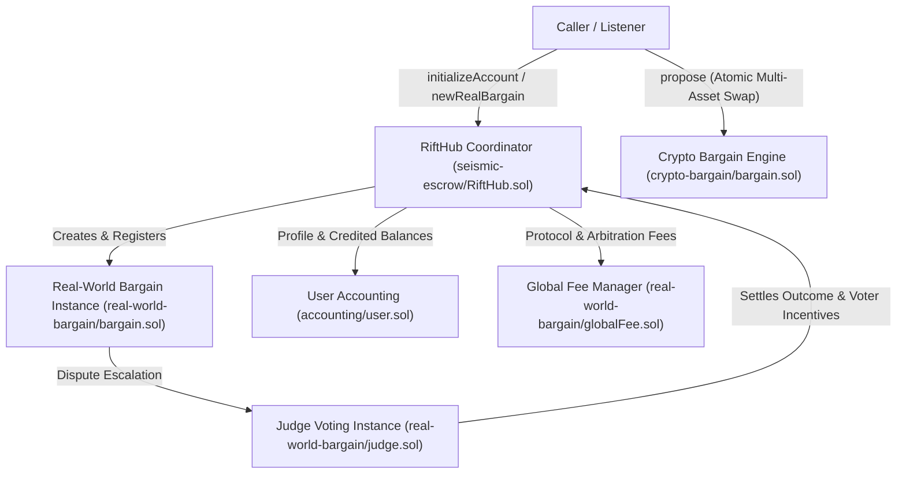

# Rift Escrow Protocol

> 🚧 **Status: Under Active Development (WIP)**  
> This protocol is actively being built and hardened for the Seismic Network (`Solidity 0.8.34`, `via-IR`, inline assembly optimization). Cross-contract deployer hooks, fee-settlement wiring, shielded state migration (`suint` / `sbytes`), and the automated Foundry test suite are still in progress — **unaudited and not intended for production funds**.

**Rift Escrow** is a gas-optimized, modular multi-asset escrow and decentralized arbitration suite under development as part of the broader **[Rift Protocol](https://riftprotocol.xyz)** DeFi ecosystem on Seismic.

---

## Architecture Overview



---

## Key Engineering Design

- **Atomic Multi-Asset Escrow (`crypto-bargain/bargain.sol`):** Supports Native tokens, ERC20 tokens, and ERC721 NFTs inside bounded `cryptoDeal` structs (`<= 10` ERC20 + `<= 10` ERC721 assets per side) with balance-delta checks on transfers.
- **Two-Party Real-World Settlement & Arbitration (`real-world-bargain/`):** Supports bilateral agreement confirmation, deadline expiry refunds, Merkle-root or token/stake-gated voter eligibility, tie-extension vote deadlines via assembly storage slots, and proportional juror incentive settlement.
- **Low-Level Assembly & Memory Optimization (`RiftHub.sol`, `accounting/user.sol`, `lib/pureFunc.sol`):**
  - Bit-packs `(address buyer, address seller)` into single 32-byte `bytes32` keys (`shr(64, buyer) | shl(96, seller)`) for `dealers` / `allJudges` slot lookups.
  - Computes dynamic keccak keys directly against `mload(0x40)` scratch memory without unnecessary ABI-encoding heap expansion.
  - Emits packed 4-byte custom-error selectors (`mstore(0, shl(224, selector)); revert(0, 4)`).
- **`via-IR` Compilation Pipeline:** Targets Solidity `0.8.34` with `--via-ir` to resolve stack depth across deep escrow structs while optimizing Yul paths.

---

## Module Breakdown & Development Status

| Module | File(s) | Status | Notes |
| --- | --- | --- | --- |
| **Protocol Hub** | [`seismic-escrow/RiftHub.sol`](seismic-escrow/RiftHub.sol) | 🚧 WIP | Deal registry, judge lifecycle hooks & settlement entrypoints (`accountInitializer` deployer & `globalFee` callback wiring in progress) |
| **Crypto Multi-Asset Swap** | [`seismic-escrow/crypto-bargain/bargain.sol`](seismic-escrow/crypto-bargain/bargain.sol) | 🚧 Draft Implemented | Atomic Native / ERC20 / ERC721 swap proposals |
| **Real-World Escrow & Arbitration** | [`seismic-escrow/real-world-bargain/`](seismic-escrow/real-world-bargain) | 🚧 WIP | `bargain.sol`, `judge.sol`, `bargainDeployer.sol`, `judgeDeployer.sol`, `globalFee.sol` (`judgeDeployer` address & fee hooks pending integration) |
| **User Accounting & Staking** | [`seismic-escrow/accounting/`](seismic-escrow/accounting) | 🚧 WIP | `user.sol` profile state & creditor tracking (`accountInitializer.sol` incomplete) |
| **Shared Types & Assembly Helpers** | [`seismic-escrow/lib/`](seismic-escrow/lib) | ✅ Active | `DataTypes.sol`, `error.sol`, `pureFunc.sol`, `safeFunctions.sol` |

---

## Roadmap

- **Milestone 1 (In Progress):** Complete deployer wiring (`RiftHub` ↔ `accountInitializer` ↔ `judgeDeployer` ↔ `globalFee`), resolve edge-case accounting checks, and add full `sforge` unit + fuzz test coverage.
- **Milestone 2 (Planned):** Migrate sensitive deal metadata, amounts, and counter-party identifiers to Seismic shielded storage types (`suint256`, `sbytes`) using `CSTORE`/`CLOAD` and encrypted `seismic-viem` logs.
- **Milestone 3 (Planned):** Security review and public Seismic Testnet deployment alongside [Rift CLMM](https://github.com/Shahrokh20000/rift-clmm).

---

## Development Setup

This codebase targets **Seismic Foundry** (`sforge`, `sanvil`) and `--via-ir`:

```bash
# Install dependencies (OpenZeppelin)
sforge install

# Compile contracts via Yul IR pipeline
sforge build --via-ir

# Launch local Seismic test node
sanvil
```

---

## License & Security

Released under the [MIT License](LICENSE). See [SECURITY.md](SECURITY.md) for pre-audit disclaimers and responsible disclosure guidelines.
